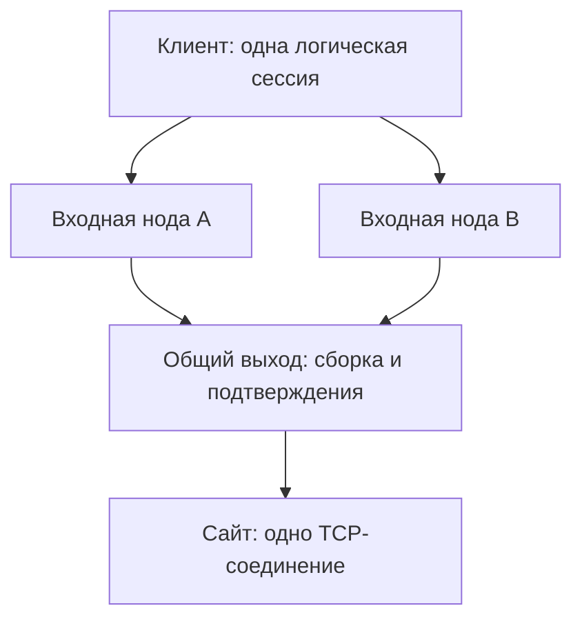

# Экспериментальное объединение нескольких путей

**Русский** | [English](BONDING.en.md)

`--bond` позволяет передавать части **одного TCP-потока** через несколько входных
нод. Общая выходная нода собирает их и держит одно соединение с назначением.
Режим нужно включить явно; обычные режимы `--balance` распределяют целые потоки.



Это исследовательская реализация поверх HTTP/2/TLS, не MPTCP и не Multipath QUIC.
Она проверяет порядок, повтор блоков и сохранение соединения при отказе входа.
Она пока не доказывает ускорения и устойчивости к ТСПУ.

## Запуск на трёх серверах

На выходе и каждой входной ноде установите свой действительный сертификат.
Во всех процессах задайте одинаковые `FOXTUNNEL_USER` и `FOXTUNNEL_PASSWORD`.
Все узлы должны быть явно доверенными: TLS завершается на каждой ноде, и каждая
имеет доступ к туннелируемому потоку. HTTPS самого приложения остаётся сквозным,
если приложение его использует. Часы клиента и выхода должны быть синхронизированы:
новый токен принимается в течение 30 секунд после создания, допустимое опережение —
до 5 секунд. Это ограничивает повтор старого открытия после очистки состояния.

На общей выходной ноде:

```sh
./foxtunnel server --listen :443 --cert exit.crt --key exit.key \
  --web-root /srv/public-site --bond-hub
```

На входной ноде A:

```sh
./foxtunnel server --listen :443 --cert node-a.crt --key node-a.key \
  --web-root /srv/public-site --bond-upstream https://exit.example
```

На B — та же команда с её сертификатом и тем же `--bond-upstream`.
Для частного CA общего выхода на входных нодах нужен `--bond-ca-cert exit-ca.pem`.
Проверка сертификата и h2 ALPN обязательна, редиректы не выполняются.
`--bond-hub` и `--bond-upstream` взаимоисключающие.

На клиенте:

```sh
./foxtunnel client --server https://node-a.example \
  --fallback-server https://node-b.example --bond \
  --connect-timeout 15s --fallback-attempt-timeout 5s
```

До восьми входных нод; как минимум две должны быть настроены, но во время
работы достаточно одного сохранившегося пути. `--ca-cert` добавляет доверие
сертификатам входов. Для экспериментального NSS добавьте `--tls-backend nss`
в сборке с `-tags nss`. Связь входов с выходом пока использует Go TLS.
`--balance` применяется к обычному CONNECT; у `--bond` свой адаптивный выбор.
`--padding` с объединением пока несовместим и явно отклоняется.

## Выбор пути и сохранение порядка

Планировщик учитывает число текущих запросов и сглаженное время HTTP-обмена
(7/8 старой оценки + 1/8 новой). Новый путь получает пробный запрос по требованию,
без фонового сканирования. После сетевой ошибки он на пять секунд уступает место
доступным. При отсутствии альтернатив охлаждающийся путь остаётся допустимым.
Это оценка полного запроса с ожиданием выхода, не чистый RTT и не измерение
свободной полосы.

До четырёх блоков отправки и четырёх запросов получения обрабатываются параллельно,
в том числе при коротких чтениях SOCKS5. Блок содержит до 32 КиБ. Номер блока
сохраняется при повторе через другую ноду. Общий выход записывает блоки в один
сокет по порядку и подтверждает только после записи в этот сокет. Уже доставленный
номер не записывается повторно; несовпадающий дубликат ожидающего блока отклоняется.

Получение использует последовательные номера и накопительное подтверждение
прочитанных блоков. Выход держит ограниченное окно; клиент выдаёт данные по порядку.
Пустое ожидание возвращает 204 до таймаута HTTP-попытки, а не имитирует сбой узла.
Повторы 408/429/503/504 и временных сетевых ошибок разрешены только для этих
операций с идентификатором сессии. Обычный CONNECT по-прежнему не повторяется
при HTTP-ошибке. Ошибки сертификата, TLS и несовместимости режима конечны.

Случайный идентификатор экземпляра выхода привязывает дальнейшие операции к
одному процессу. Если входы ошибочно указывают разные выходы, запрос с уже
полученной привязкой отклоняется до работы с назначением. Потерянный первый
ответ открытия может оставить неиспользуемый сокет до очистки, но данные
приложения не распределяются между разными выходами.

## Ограничения ресурсов и восстановления

На выходе окно отправки ограничено восемью блоками, получение — восемью блоками
данных и возможным маркером EOF. На клиенте — четыре блока в каждом направлении.
Дополнительно расходуются память HTTP/TLS и буферы сокетов. По умолчанию не более
256 активных сессий; `--max-tunnels` задаёт предел сессий выхода и общий предел
одновременно обрабатываемых авторизованных CONNECT/RPC-запросов сервера.
Закрытые сессии освобождают данные, но сохраняют запись против повторного открытия не менее двух минут после
последнего обращения; удаление происходит при последующих запросах.
Всего не более 4096 записей. Бездействие сессии две минуты
закрывает сокет даже без новых запросов. Установка сокета назначения — до 10 секунд.

Установка клиентской сессии ограничена `--connect-timeout`; отдельная попытка —
`--fallback-attempt-timeout` (в этом режиме не менее 100 мс). Операция пробует
каждую ноду не более раза. При отказе всех путей поток завершается. Перезапуск
или отказ общего выхода также теряет сессии: дисковой репликации и переноса
выходного сокета нет. Полузакрытие отправки поддерживается после подтверждения
предыдущих блоков.

Смена входа не исправит отказ самого сайта или ограничение выходного IP.
Протокол не читает зашифрованные HTTP-ответы приложения и не воспроизводит
запросы страниц. Общая полоса клиента/выхода и пересечение маршрутов ограничивают
выигрыш; дополнительные HTTP-запросы, TLS и сборка создают расходы. Гарантии
суммы скоростей нод нет.

## Проверки и следующие шаги

Проверены настоящий SOCKS5, два HTTPS-входа, отдельный HTTPS-выход и TCP-сервис:
потеря ответа открытия, потеря подтверждения уже доставленного блока, зависание
одного входа посреди того же соединения, порядок, отсутствие дубликатов и
полузакрытие. Тест проходит с Go TLS и NSS на клиенте. Отдельно проверяются
параллельные короткие записи, границы формата/окон, закрытые/просроченные токены,
неверный выход и закрытие во время подключения.

```sh
go test -race ./... -count=1 -timeout=60s
go test -race -tags nss ./... -count=1 -timeout=60s
go test ./internal/tunnel -run '^$' \
  -bench 'Benchmark(BondedLoopback|TunnelRoundTrip)' -benchmem -benchtime=500ms -count=3
```

Нужны измерения на независимых ограниченных маршрутах: суммарная полоса, p95,
время смены пути, CPU/ОЗУ, расходы коротких сообщений и простоя. Затем — управление
по полосе, подходящее управление перегрузкой, более экономный потоковый формат,
Neqo/H3 и отдельные испытания в сетях РФ. Наблюдаемое сходство с Firefox надо
проверять повторно: эта схема меняет форму HTTP-трафика.

Первичные ориентиры: [MPTCP RFC 8684](https://www.rfc-editor.org/rfc/rfc8684.html)
и [текущая карточка Multipath QUIC](https://datatracker.ietf.org/doc/draft-ietf-quic-multipath/).
Проверенная карточка показывала draft-21; её статус не следует подменять
заявлением о поддержке в Neqo или готовности нашего прототипа.
